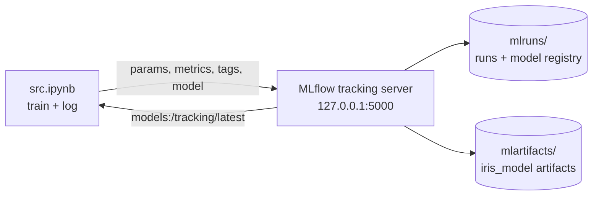

# MLflow Model Tracking

A hands-on MLflow project that logs scikit-learn Logistic Regression runs on the Iris dataset to a local tracking server, registers every model version, and loads models back for inference.

## Overview

Comparing model runs by hand (which parameters, which score, which pickle) gets messy quickly. This project uses MLflow to record that history in one place. A single notebook, `src.ipynb`, first checks the connection to a local tracking server, then trains Logistic Regression on Iris with two solvers and logs parameters, accuracy, a tag and the model with its signature and input example. Each logged model is registered as a new version of the `tracking` model, then loaded back both from the run and from the registry. The tracking store (`mlruns/`) and artifact store (`mlartifacts/`) are committed, so every run can be browsed in the MLflow UI.

## Highlights

- 20 runs across 2 experiments in `mlruns/`: `Iris` (6 runs) and `Check local host connection` (14 runs, including connection smoke tests).
- 7 registered versions of the model `tracking` (`mlruns/models/tracking/version-1` to `version-7`), each pointing at a run's `iris_model` artifact in `mlartifacts/`.
- Every logged model has an inferred signature (4 float64 inputs, int32 class output), an input example, and `conda.yaml`, `python_env.yaml` and `requirements.txt` for rebuilding its environment.
- Models are reloaded two ways: `mlflow.pyfunc.load_model(model_info.model_uri)` and `mlflow.sklearn.load_model("models:/tracking/latest")`.

## Architecture



## Results

Accuracy on a 30-sample test split (the length of the saved prediction array in `src.ipynb`, `In [34]`). All values are read from `mlruns/301404917014610055/<run>/metrics/accuracy` and the registry files in `mlruns/models/tracking/`.

| Run (Iris experiment) | Solver | Accuracy | Status | Registry version |
|---|---|---|---|---|
| receptive-cub-547 | lbfgs | 0.9000 | finished | 3 |
| fortunate-elk-916 | newton-cg | 0.9000 | finished | 4 |
| secretive-foal-506 | lbfgs | 0.9667 | finished | 5 |
| wistful-perch-928 | newton-cg | 0.9667 | failed, no model logged | none |
| nimble-gull-36 | lbfgs | 0.9333 | finished | 6 |
| learned-worm-870 | newton-cg | 0.9333 | finished | 7 |

The notebook's saved output matches the last pair: `In [36]` prints an accuracy of `0.9333333333333333`, and `In [37]` and `In [42]` report creating versions 6 and 7.

Each lbfgs run was followed by a newton-cg run, and every such pair scored the same. The spread from 0.90 to 0.97 between pairs comes from `train_test_split` having no fixed `random_state`, so each pair was evaluated on a different split. The `Check local host connection` experiment holds 7 more lbfgs runs (all 0.9000, two of them registered as versions 1 and 2), 6 smoke-test runs with placeholder metrics, and 1 empty failed run.

## Tech stack

Python 3.12, MLflow 2.16.2, scikit-learn 1.4.2, pandas, Jupyter.

## Quickstart

```bash
pip install -r requirements.txt jupyter
mlflow server --host 127.0.0.1 --port 5000 \
  --backend-store-uri ./mlruns --artifacts-destination ./mlartifacts   # run from the repo root
```

Open http://127.0.0.1:5000 to browse the saved runs and the `tracking` model versions. To log new runs, open `src.ipynb` and run all cells against the same server. The saved runs were made with MLflow 2.16.2 and scikit-learn 1.4.2 (see any `MLmodel` file), so pin those versions if a newer release does not read the store.

## Project structure

```
src.ipynb          training, logging, registration and inference notebook
requirements.txt   mlflow, scikit-learn
mlruns/            tracking store: 3 experiments (including Default), 20 runs, model registry
mlartifacts/       logged iris_model artifacts (model.pkl, MLmodel, environments, input examples)
```

## Limitations and next steps

- Small, single-model demo: one dataset, one algorithm, two solvers, and a 30-sample test set where one misclassification moves accuracy by 0.033.
- The split is not seeded, so runs are not reproducible. Fixing `random_state` and using cross-validation would give comparable scores.
- `models:/tracking/latest` relies on the stage-based `get_latest_versions`, which MLflow marks as deprecated (warning in `src.ipynb`, `In [49]`). Registry aliases are the replacement.
- Next: separate smoke-test runs from real experiments, and compare more models with nested runs.

## License

No license specified yet.
